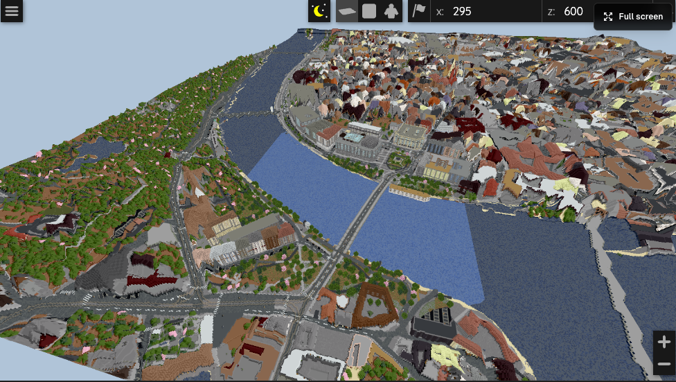
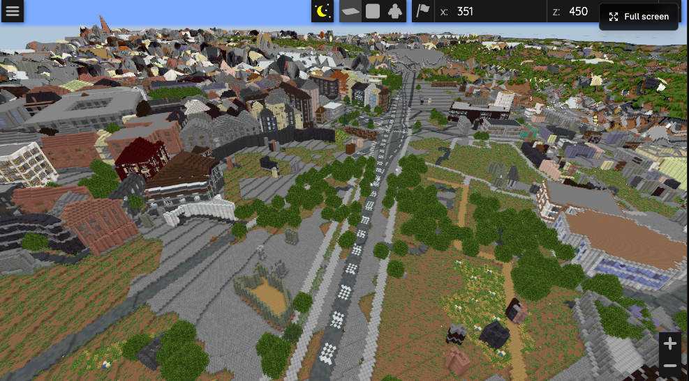

# MapMC Worlds

Playable Minecraft worlds generated from real-world map areas with [MapMC](https://mapmc.app).

MapMC turns real map data into downloadable Minecraft worlds. These packages are shared so builders can preview, test, edit, and build on top of real-place starting points.

## Available Worlds

| World | Edition | Download | Preview |
|---|---|---|---|
| [Brooklyn, New York, United States](worlds/brooklyn-nyc/) | Bedrock | [Download](worlds/brooklyn-nyc/mapmc-world-bedrock.mcworld) | Pending |
| [Centennial Square, Sydney, Australia](worlds/centennial-square-sydney/) | Java | [Download](worlds/centennial-square-sydney/mapmc-world-java.zip) | Pending |
| [Centrum, Amsterdam, Nederland](worlds/centrum-amsterdam/) | Java | [Download](worlds/centrum-amsterdam/mapmc-world-java.zip) | [MapMC 3D preview](https://mapmc.app/zh/m/11Mn5XzbiKkW) |
| [Josefov, Praha, Cesko](worlds/josefov-prague/) | Java | [Download](worlds/josefov-prague/mapmc-world-java.zip) | [MapMC 3D preview](https://mapmc.app/zh/m/_WTXJaLga8C0) |
| [Manhattan Community Board 5, New York, United States](worlds/manhattan-community-board-5/) | Java | [Download](worlds/manhattan-community-board-5/mapmc-world-java.zip) | [MapMC 3D preview](https://mapmc.app/zh/m/U2D84ITE910n) |
| [Mitte, Berlin, Deutschland](worlds/berlin-mitte/) | Java | [Download](worlds/berlin-mitte/mapmc-world-java.zip) | [MapMC 3D preview](https://mapmc.app/zh/m/e58eA_skztTg) |
| [Municipio Roma I, Roma, Italia](worlds/roma-i/) | Java | [Download](worlds/roma-i/mapmc-world-java.zip) | [MapMC 3D preview](https://mapmc.app/zh/m/MAijxYDLsUoo) |
| [Paris 4e Arrondissement, Paris, France](worlds/paris-4e/) | Java | [Download](worlds/paris-4e/mapmc-world-java.zip) | [MapMC 3D preview](https://mapmc.app/zh/m/83_gd0p1M5aD) |
| [South of Market, San Francisco, United States](worlds/south-of-market-san-francisco/) | Java | [Download](worlds/south-of-market-san-francisco/mapmc-world-java.zip) | Pending |
| [St Paul's, City of London, United Kingdom](worlds/st-pauls-london/) | Java | [Download](worlds/st-pauls-london/mapmc-world-java.zip) | Pending |
| [Venezia-Murano-Burano, Venezia, Italia](worlds/venice-murano-burano/) | Java | [Download](worlds/venice-murano-burano/mapmc-world-java.zip) | [MapMC 3D preview](https://mapmc.app/zh/m/ueqXJbX1upIA) |
| [Washington, United States](worlds/washington-dc-bedrock/) | Bedrock | [Download](worlds/washington-dc-bedrock/mapmc-world-bedrock.mcworld) | Pending |
| [l'Eixample, Barcelona, Espana](worlds/barcelona-eixample/) | Java | [Download](worlds/barcelona-eixample/mapmc-world-java.zip) | [MapMC 3D preview](https://mapmc.app/zh/m/NkVb7Hn8FlZ9) |
| [Downtown Dubai, Dubai, United Arab Emirates](worlds/downtown-dubai/) | Java | [Download](worlds/downtown-dubai/mapmc-world-java.zip) | [MapMC 3D preview](https://mapmc.app/zh/m/ePTq94oAai8F) |
| [Yau Tsim Mong District, Hong Kong, China](worlds/yau-tsim-mong-hong-kong/) | Java | [Download](worlds/yau-tsim-mong-hong-kong/mapmc-world-java.zip) | [MapMC 3D preview](https://mapmc.app/zh/m/vSE0ll5P9jD0) |
| [White House, 1600 Pennsylvania Avenue Northwest](worlds/white-house-washington-dc/) | Java | [Download](worlds/white-house-washington-dc/mapmc-world-java.zip) | Pending |
| [Dogenzaka 2-chome, Shibuya, Japan](worlds/shibuya-dogenzaka/) | Java | [Download](worlds/shibuya-dogenzaka/mapmc-world-java.zip) | Pending |

## How to Use These Files

### Java Edition

1. Download the world zip.
2. Create a new folder for the world.
3. Extract the zip contents into that folder.
4. Move the folder into your Minecraft Java saves directory.
   - macOS: `~/Library/Application Support/minecraft/saves`
   - Windows: `%APPDATA%\.minecraft\saves`
   - Linux: `~/.minecraft/saves`
5. Launch Minecraft Java Edition and open it from Singleplayer.

Make sure `level.dat` is inside the world folder after extraction.

### Bedrock Edition

1. Download the `.mcworld` file.
2. Open it with Minecraft Bedrock Edition.
3. Import the world and open it from your world list.

## Screenshots

## Disclosure

These worlds are generated with MapMC from real-world map data. MapMC is not official Minecraft and is not affiliated with Mojang or Microsoft.
