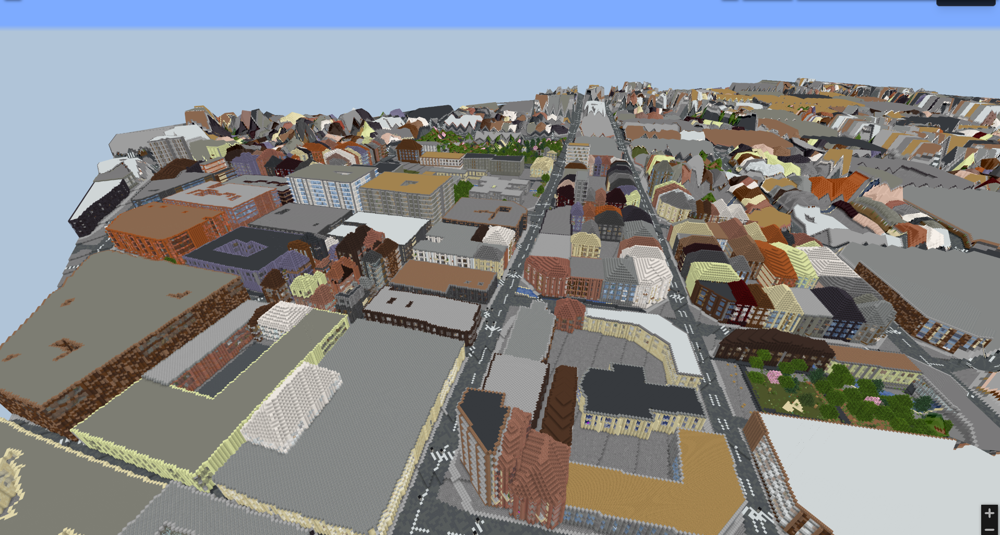

# MapMC Worlds

Playable Minecraft worlds generated from real-world map areas with [MapMC](https://mapmc.app).

MapMC turns real map data into downloadable Minecraft worlds. These packages are shared so builders can preview, test, edit, and build on top of real-place starting points.

## Available Worlds

| World | Edition | Download | Preview |
|---|---|---|---|
| Barcelona Eixample, Spain | Java 1.21.4 | [Download Java world](worlds/barcelona-eixample/mapmc-world-java.zip) | [MapMC 3D preview](https://mapmc.app/zh/m/NkVb7Hn8FlZ9) |

## Barcelona Eixample

This world is based on the Eixample area in Barcelona. It includes roads, terrain, city blocks, and building footprints generated from real-world map data.

It is not a perfect hand-built replica. Treat it as a playable starting point for city-building, exploration, and editing.

Screenshots:

## Install Notes

1. Download the world zip.
2. Create a folder named `MapMC - Barcelona Eixample`.
3. Extract the zip contents into that folder.
4. Move that folder into your Minecraft Java saves directory.
   - macOS: `~/Library/Application Support/minecraft/saves`
   - Windows: `%APPDATA%\.minecraft\saves`
   - Linux: `~/.minecraft/saves`
5. Launch Minecraft Java Edition and open it from Singleplayer.

Make sure `level.dat` is inside the world folder after extraction.

## Disclosure

These worlds are generated with MapMC from real-world map data. MapMC is not official Minecraft and is not affiliated with Mojang or Microsoft.
