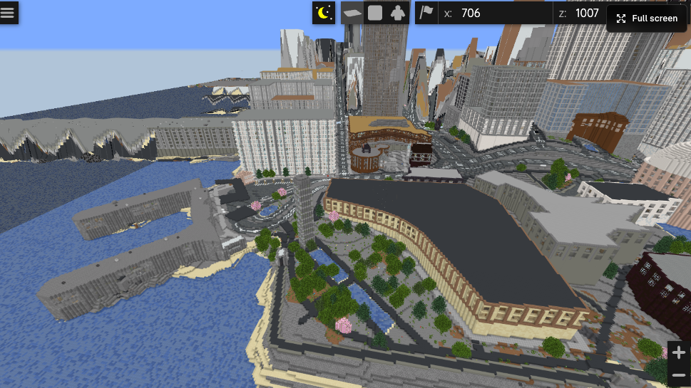
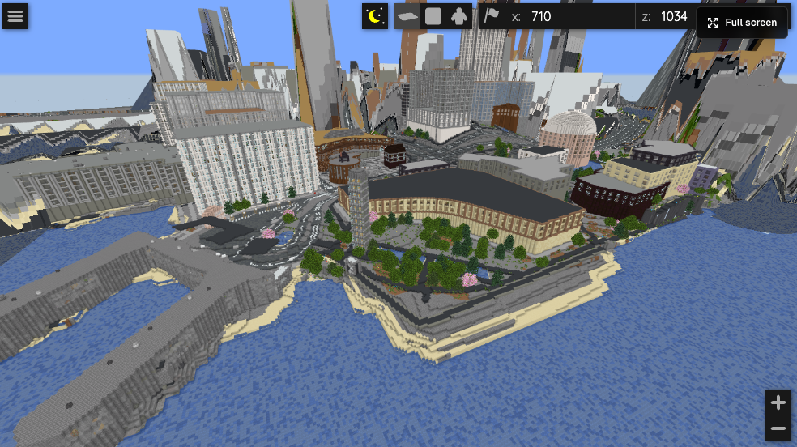

# Yau Tsim Mong District, Hong Kong, China as a Minecraft Java World

This is a Minecraft Java world based on Yau Tsim Mong District, Hong Kong, China.

It was generated with [MapMC](https://mapmc.app) from real-world map data. It is a playable starting point for city-building, exploration, and editing rather than a perfect hand-built replica.

- Edition: Java
- Package: `mapmc-world-java.zip`
- Package size: 27.6 MB
- MapMC 3D preview: https://mapmc.app/zh/m/vSE0ll5P9jD0

## Install

1. Download `mapmc-world-java.zip`.
2. Create a folder named `MapMC - Yau Tsim Mong District, Hong Kong, China`.
3. Extract the zip contents into that folder.
4. Move that folder into your Minecraft Java saves directory.
5. Launch Minecraft Java Edition and open it from Singleplayer.

Make sure `level.dat` is inside the world folder after extraction.

## Screenshots

## Disclosure

This world was generated with MapMC from real-world map data. MapMC is not official Minecraft and is not affiliated with Mojang or Microsoft.
